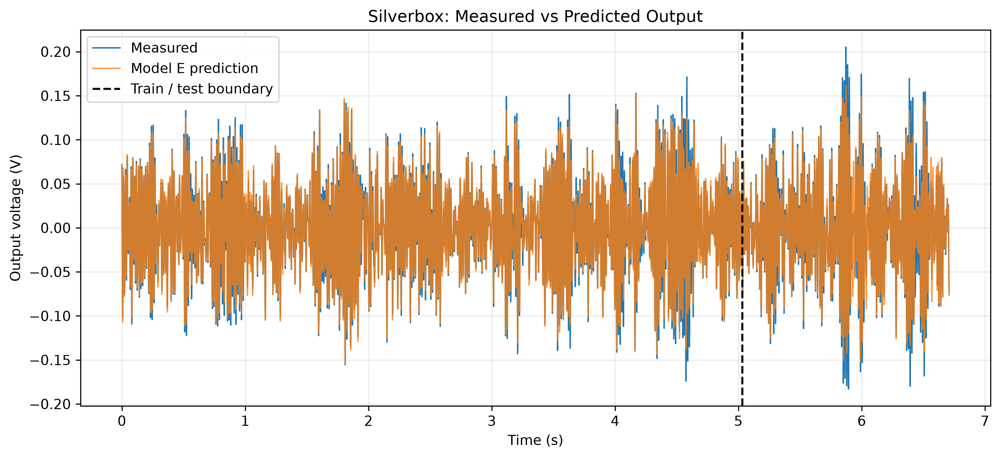
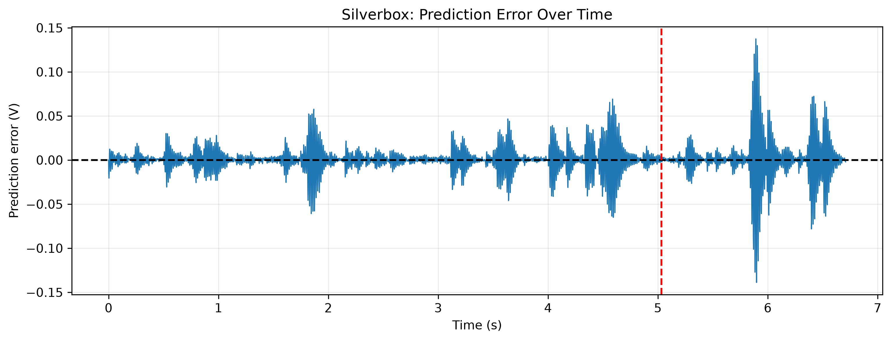
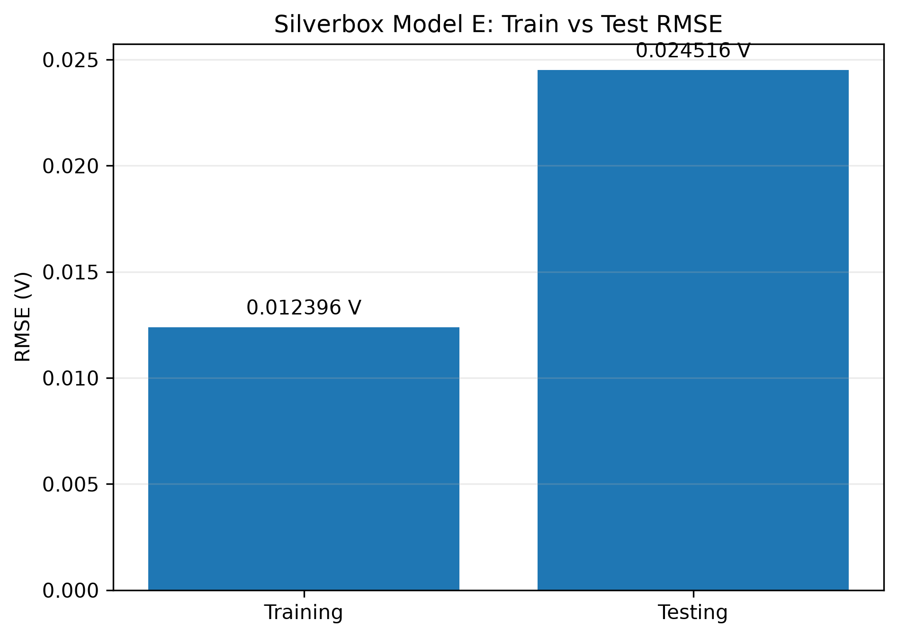
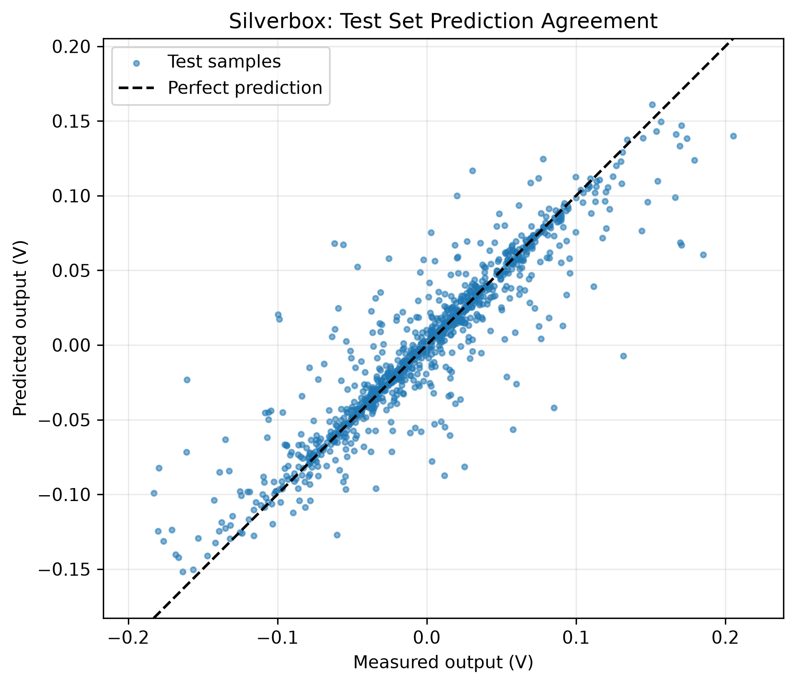

# Task 6 — LangGraph Multi-Agent System for Silverbox Oscillator Modeling

**Homework 2, Task 1 extension:** The separate [human-in-the-loop guide](homework2_task1/README.md)
adds clarification and approval turns with durable LangGraph interruption and
resume. The Task 6 workflow described below remains available unchanged.

**Homework 2, Task 2:** The [simulated scattering-bench guide](homework2_task2/README.md)
documents the noisy beam-focusing experiment. The completed four-trial agent
run, including its [summary and figures](outputs/task2_noisy_20261013_023751_907807/),
reported a mean final enhancement of **11.777839**. The Task 1
[run evidence](homework2_task1/evidence.md) records the clarification,
refusal, approval, and measured RMSE from its completed workflow. Screen
recordings are supplied separately with the submission email.

## Overview

This project implements a multi-agent AI workflow using **LangGraph** and the **Groq API** to reproduce and evaluate a neural-network model of the Silverbox nonlinear oscillator from Task 5.

The system coordinates scientific reasoning, general explanations, Python code generation, execution, and result validation.

**The main result is a successful continuous RK4 evaluation of the existing Model E checkpoint, with a test RMSE of 0.024515912 V.**

## Multi-Agent Architecture

The workflow contains four agents:

| Agent | Responsibility |
|---|---|
| **Orchestrator** | Uses an LLM to select the next agent, provide instructions, and justify routing decisions. |
| **Scientist** | Develops a scientific plan and explains the physical and mathematical modeling approach. |
| **General** | Provides general explanations and supporting reasoning. |
| **Executor** | Generates Python code and uses a controlled execution interface to evaluate the model. |

The agents communicate through a shared LangGraph state containing conversation messages, routing decisions, execution status, and test RMSE.

### Workflow

```text
User task
    |
    v
Orchestrator
    |
    +----> Scientist ----+
    |                   |
    +----> General -----+----> Orchestrator
    |                   |
    +----> Executor ----+
              |
              v
       Generated Python
              |
              v
         Human review
              |
              v
       Approved execution
              |
              v
       Test RMSE result
              |
              v
         Orchestrator
              |
              v
            Finish
```

The Orchestrator may finish only after a Python script has actually executed successfully and produced a valid test RMSE. The workflow limits the number of routing decisions to eight.

**Safety note:** Generated Python code is reviewed before execution. The local AST checks and subprocess timeout are useful safeguards, but they do not provide a complete security sandbox.

## Scientific Experiment

The evaluation reproduces the Task 5 Silverbox oscillator experiment using its existing data-processing pipeline and trained Model E checkpoint.

- **Dataset:** 4,096 consecutive time samples
- **Training segment:** 3,072 samples
- **Test segment:** 1,024 samples
- **Sampling frequency:** approximately 610.35 Hz
- **Model:** neural acceleration model with two hidden layers of width 128
- **Numerical integrator:** fourth-order Runge–Kutta (RK4)
- **Evaluation:** continuous free-run rollout without resetting the state at the train/test boundary

The project evaluates the existing trained checkpoint. **It does not retrain the neural network.**

**Relationship to Task 5:** The Task 5 repository now also contains Model F,
whose best saved run has a lower test RMSE. The Task 6 workflow documented here
evaluates **Model E** specifically, so its reported RMSE should be read as a
reproduction of that checkpoint rather than the current best Task 5 score.

### Results

| Metric | Value |
|---|---:|
| Training RMSE | 0.012396316 V |
| Test RMSE | **0.024515912 V** |
| Python execution exit code | 0 |
| Final workflow state | `finish` |
| Orchestrator decisions in successful run | 3 |

The test RMSE was reproduced independently during the multi-agent execution and the plotting workflow.

## Scientific Visualizations

### Measured vs Predicted Output



### Prediction Error



### Training vs Testing RMSE



### Test Prediction Agreement



## Project Structure

```text
task6_langgraph_multiagent/
├── agents/
│   ├── orchestrator.py
│   ├── scientist.py
│   ├── general.py
│   └── executor.py
├── tools/
│   └── python_runner.py
├── state.py
├── graph.py
├── workflow.py
├── main.py
├── plot_results.py
├── requirements.txt
├── .gitignore
├── task5_reference/
└── outputs/
    └── plots/
```

The `task5_reference/` directory contains the Task 5 source code, processed data, and the existing Model E checkpoint required for reproducing the reported experiment.

## Installation

The project was developed on macOS with Python 3.14.

Create and activate a virtual environment:

```bash
python3 -m venv .venv
source .venv/bin/activate
```

Install dependencies:

```bash
python3 -m pip install -r requirements.txt
```

Configure the Groq API key in your local shell:

```bash
export GROQ_API_KEY="YOUR_GROQ_API_KEY"
```

**Never commit a real API key to GitHub.**

## Running the Multi-Agent Workflow

Start the multi-agent system:

```bash
python3 main.py
```

The system uses the Groq-hosted `openai/gpt-oss-120b` model for agent reasoning.

The Executor generates a Python evaluation script and stops at `awaiting_review`. The generated script must be inspected before its execution is approved.

The workflow state is saved to:

```text
outputs/workflow_state.json
```

The reviewed execution result can then be passed to the workflow continuation functions in `workflow.py`, allowing the Orchestrator to evaluate the actual RMSE and decide whether to finish.

The review and continuation currently use separate Terminal actions; there is no single-command automatic approval.


## Obtaining the Task 5 Reference Files

The Task 5 source code, processed dataset, and Model E checkpoint
are stored in a separate repository.

Clone it inside the Task 6 project:

    git clone https://github.com/Arenananyan/physics_informed_neural_network_for_the_silverbox-oscillator.git task5_reference

Required files:

    task5_reference/scr/model.py
    task5_reference/scr/integrator.py
    task5_reference/data/processed/silverbox_excerpt.npz
    task5_reference/results/checkpoints/model_e_w128_s2000.pt

This experiment evaluates the existing checkpoint without retraining.

## Reproducing the Scientific Plots

Once the Task 5 reference data and checkpoint are available, run:

```bash
python3 plot_results.py
```

The script regenerates four PNG visualizations in `outputs/plots/` and verifies that the calculated test RMSE agrees with the reported result.

## Original Task 5 Reference

The scientific experiment is based on the previous Task 5 project:

https://github.com/Arenananyan/physics_informed_neural_network_for_the_silverbox-oscillator

## Limitations

- Model E is evaluated from a pre-trained checkpoint rather than trained from scratch.
- Code approval and workflow continuation require separate Terminal actions.
- The Python runner is not a fully isolated sandbox.
- The reported RMSE applies to the specified Silverbox excerpt and train/test split.

## Conclusion

The project demonstrates an LLM-orchestrated multi-agent workflow that combines scientific planning, executable Python code generation, human-reviewed execution, and quantitative evaluation of a nonlinear dynamical system.
